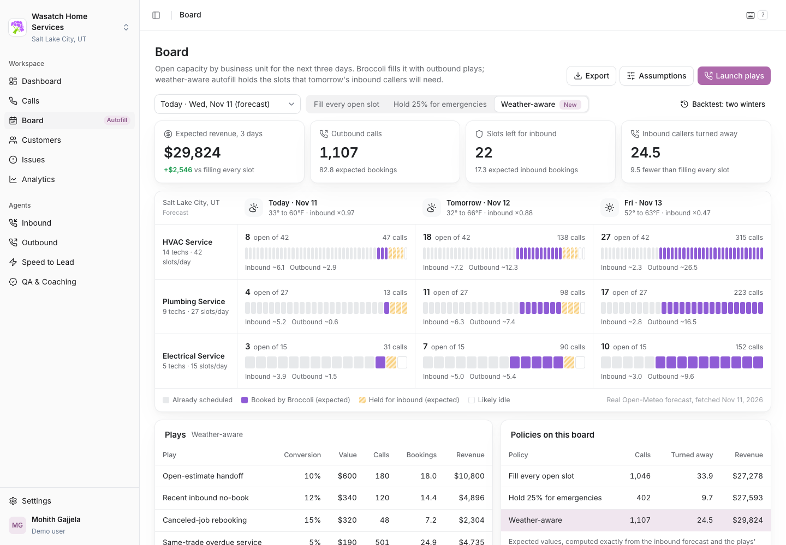

# Weather-aware autofill for the Broccoli Board

**Live demo:** https://mohith26.github.io/broccoli-weather-aware-autofill/

Broccoli's Board shows each business unit's open capacity for today, tomorrow and the day after, and the autofill agent books outbound plays (member tune-ups, open estimates, canceled-job rebookings) into the empty slots. Every slot it fills is a slot an inbound caller can't get later. On a cold morning that's a bad trade: a no-heat repair is worth several tune-ups, and a caller who can't get a slot calls a competitor. This concept adds a **weather-aware** policy to the Board. It forecasts how many inbound callers will still want each day from the temperature forecast, then decides how many calls of each play to place in each cell to maximize expected revenue. It holds slots when it's cold and fills them when it's mild.



## Headline result

Backtest over two real Salt Lake City winters (302 board snapshots, Nov 1 - Mar 31 in 2024-25 and 2025-26, actual temperatures from Open-Meteo, 40 simulated days per snapshot with the same inbound callers for every policy):

- **+9.2% revenue per 3-day board** vs filling every open slot (+$3,643 per board).
- **44% fewer callers turned away on cold days** (next day below 25°F): 44.7 vs 79.7 per board.
- **+$1,344 per board vs a fixed 25% emergency reserve**, the rule ServiceTitan's own capacity docs use as an example: the reserve protects cold days but idles 26.7 slots per board on mild days.

Source: `results/results.json` (`headline`, `all`, `cold`, `mild`, per-day rows).

| Days | Policy | Revenue per board | Callers turned away | Idle slots | Outbound calls |
|---|---|---|---|---|---|
| All 302 | Fill every open slot | $39,722 | 51.9 | 2.1 | 1,117 |
| All 302 | Hold 25% for emergencies | $42,020 | 20.0 | 19.5 | 421 |
| All 302 | **Weather-aware** | **$43,365** | 31.5 | 6.8 | 952 |
| Cold (<25°F, 24) | Fill every open slot | $45,588 | 79.7 | 1.2 | 1,110 |
| Cold (<25°F, 24) | Hold 25% for emergencies | $50,080 | 40.3 | 11.1 | 418 |
| Cold (<25°F, 24) | **Weather-aware** | **$51,023** | 44.7 | 7.5 | 695 |
| Mild (>=40°F, 115) | Fill every open slot | $36,227 | 35.8 | 2.9 | 1,122 |
| Mild (>=40°F, 115) | Hold 25% for emergencies | $36,671 | 10.4 | 26.7 | 423 |
| Mild (>=40°F, 115) | **Weather-aware** | **$38,691** | 25.8 | 5.7 | 1,104 |

The weather-aware policy turns away more callers than the 25% reserve on average, on purpose: when a $600 open-estimate booking is worth more than a $520 repair that might not come, it books the estimate.

## How it works

1. **Cold response (real data).** A Poisson GLM, fitted by IRLS with a negative-binomial dispersion, on 577 days of NYC 311 "HEAT/HOT WATER" complaints against daily mean temperature (Open-Meteo). Features: degrees below 65°F and its square, plus day of week. Pseudo-R² 0.81, dispersion alpha 0.27. The fitted curve gives a demand multiplier relative to a 45°F day (about ×3.5 at 15°F). It is used as the shape of no-heat demand; plumbing gets half the log-response, electrical none.
2. **Board cells.** For each business unit and day: capacity, already-booked slots, and inbound callers still to come for that day, `NB(base x day share x multiplier(forecast temperature), alpha)`.
3. **Exact expected value of a plan.** Outbound bookings from each play are Binomial(calls, conversion); they take slots first, in order of value; inbound takes what is left. Expected value = sum of play values times expected booked slots + repair value x loss share x `E[min(D, slots left)]` - call cost, all computed exactly on the integer lattice.
4. **Plan.** Greedy marginal-value allocation of single calls across cells and plays, under per-play audience limits (shared across a unit's three days) and a call budget. In one cell with one play the objective is concave in calls, so greedy is optimal (property test against brute force); with several plays it stays within 1% of brute force in tests. The Littlewood protection level (slots worth more to inbound than to a tune-up) is shown in each cell's drill-down.
5. **Baselines.** Fill every open slot, and hold 25% of capacity for emergencies, both choosing plays in order of expected value per call.
6. **Backtest.** Each winter day is a board snapshot. Policies plan on a forecast (actual temperature plus 1.5 / 2.5 / 3.5°F Gaussian error for the three days) and are scored on 40 simulated outcomes using the actual temperature, with common random numbers for inbound demand.

The app (static HTML/CSS/ES modules) recomputes the plan live for today's Open-Meteo forecast (fetched in the browser on load, with the committed Nov 11 snapshot as the offline fallback) or any replayed winter day, and lets you change the assumptions (ticket values, loss share, call cost, call budget), launch or pause plays (saved in localStorage), drill into any cell, and export the plan (CSV/JSON) and backtest (CSV).

## Run it

```sh
node --test test/*.test.js     # 13 tests: NB math, GLM recovery, exact value vs Monte Carlo, greedy vs brute force, Littlewood, headline consistency
node scripts/build.mjs         # refits, re-plans and re-runs the backtest (~1 s)
python3 -m http.server         # then open http://localhost:8000
```

Raw inputs are committed under `data/raw/` (NYC 311 daily counts via the Socrata API, Open-Meteo archive and forecast JSON).

## Honest limitations

- **The company is synthetic.** Capacity, already-booked shares, audiences, base inbound volume and ticket values are assumptions (editable in the app). Base volume was set so that a typical winter day's inbound demand is about 60% of open capacity.
- **The demand shape is borrowed.** NYC tenant heat complaints are a public proxy for no-heat demand, not HVAC call data. The real system would fit the same model on each customer's own call history (Broccoli has it), per business unit and lead time.
- **No archived forecasts.** Forecast error is simulated as Gaussian noise on the actual temperature; real forecast errors are larger in some regimes.
- **Turned-away callers:** 60% are assumed lost to a competitor and 40% rebook later; that share drives how much a held slot is worth.
- **The plays' conversion rates are Broccoli's template defaults**, not measured per customer, and they are treated as fixed and independent of the day offered.
- **The app chrome is reconstructed.** The logged-in Broccoli app is not public. The shell uses the production stylesheet's tokens (shadcn sidebar variables, Broccoli UI "bui" tokens, call-outcome colors) and the Voice Studio launch screenshots; the sidebar items are inferred from product names and API routes in the public bundle.

## Prior art and what is new

- Protection levels for higher-value demand are classic revenue management (Littlewood 1972; EMSR). Nothing new in the math.
- ServiceTitan offers Forecast Demand (shows the weather; you manually set techs in reserve) and Adaptive Capacity rules (e.g. cap tune-ups at 75% in summer). Both are manual and static.
- Broccoli's Board and autofill agent fill empty slots with plays that carry expected conversion rates. Public material describes filling the board when it is dry; nothing describes holding slots for forecast inbound demand.
- New here: the autofill agent sizing each play per cell from a calibrated, weather-driven inbound forecast and exact expected value, so it holds slots on cold days and fills them on mild days automatically, with a backtest on real winters against both "fill everything" and a fixed reserve.

## License and data

Code: MIT. NYC 311 data: NYC Open Data terms of use. Weather: Open-Meteo (CC BY 4.0). Unofficial concept demo by Mohith Gajjela. Not affiliated with Broccoli AI.
